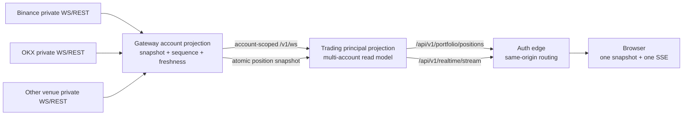
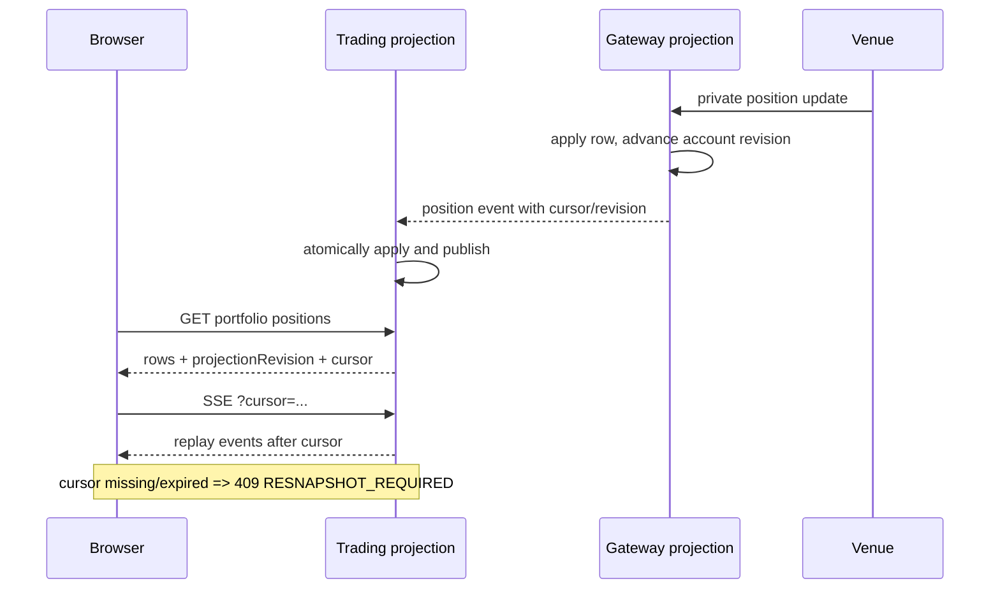

# 多交易所持仓与核心交易信息设计

状态：Phase 0–3 核心读取与实时链路已实现；持仓派生执行和 Phase 4 估值仍按本文约束后续落地
范围：手动交易页、全局持仓页、订单/成交联动、Gateway 私有数据投影  
日期：2026-08-24

## 实施记录

本次实现已经落地以下边界：

- Exchange 统一 `net/long/short` position slot，Binance、OKX、Bybit、Bitget 的 one-way/hedge 映射进入适配层。
- Gateway 按 `account + route + instrument + slot` 维护权威投影，私有事件先入投影再发布，并提供同一事件游标下的账户原子快照。
- Trading 建立 principal 级多账户读模型和独立持久化；单账户失败只使该账户 stale/unavailable，服务重启后的最后已知值不会伪装实时。
- 浏览器使用全局快照和用户级 SSE；连接正常时不再逐账户固定轮询，断线时使用受控快照 fallback。
- 交易页只读取当前账户和合约，图表只画当前账户的入场/强平线；全局页默认按账户分组，支持账户、交易所、产品、状态和搜索筛选，不跨场净额化。
- 标记价、未实现盈亏、强平价、保证金、新鲜度和来源进入统一响应；stale 行不进入默认盈亏汇总。

尚未在本次提交中开放持仓行的 `减仓/平仓` 按钮。现有下单接口缺少“按最新 PositionKey 重新读取并生成 reduce-only 意图”的独立服务端合同；在该合同和 write fence 复核完成前，不让浏览器使用缓存数量直接执行。Phase 4 的本地估值、USD 折算和分析净敞口同样保持未开放，避免把不同合约语义做错误汇总。

## 1. 结论

这套体验采用“两层视图、一个权威数据源”：

1. **交易上下文视图**只显示当前选中的账户、交易所路由和合约，用于下单、减仓、查看当前持仓及图表标记。
2. **全局持仓中心**显示当前用户所有已授权账户、所有交易所、所有产品的持仓；默认逐行保留真实账户边界，不跨交易所净额化。
3. **Gateway 是交易所账户状态的权威投影层**。私有 WebSocket 是主链路，REST 快照负责启动、校验和断线恢复；不让浏览器直接连接交易所私有流。
4. **Trading 是用户级读模型和浏览器接口层**。它汇总多个账户的 Gateway 投影，通过一个用户级 SSE 向浏览器发送变化。
5. **浏览器只维持一个核心实时连接**。首次加载使用带游标的完整快照，后续消费增量；游标断裂时重新取快照。
6. **静止的持仓不等于过期**。新鲜度由私有连接连续性和最近校验时间决定，不用“最后一次持仓数值变化时间”判断。
7. **标记价和未实现盈亏保留来源**。交易所值是权威值；需要本地计算时显示为估算值，不能用估算结果覆盖交易所事实。
8. **Toast 只负责通知，不负责承载事实**。订单、失败原因、成交和持仓必须即时落到各自的长期视图中。

## 2. 目标与非目标

### 2.1 目标

- 用户同时持有多个交易所、多个账户、多个合约时，任何一笔持仓都不会被错误合并或隐藏。
- 成交、撤单、失败、持仓变化能在秒级内反映到界面；单个交易所断线不影响其他账户继续显示。
- 所有核心数值都能回答三个问题：属于哪个账户、来自哪里、截至什么时候可信。
- 当前交易页保持专注，不把其他账户的持仓线叠到当前图表上。
- 所有从持仓派生的操作都重新经过服务端快照、规则和 write fence 校验。

### 2.2 非目标

- 第一阶段不提供跨交易所一键净平仓。
- 不默认把 Binance 多仓和 OKX 空仓合成一笔“净仓位”。
- 不在前端用通用的 `quantity × price` 公式计算所有产品的价值或盈亏。
- 不把 Trading 当前按成交谱系生成的 `positions` 账本，改名后当作交易所权威持仓使用。
- 不因为有实时流就承诺每个交易所、每个产品行具有完全相同的字段和更新频率。

## 3. 用户心智模型

### 3.1 三个范围

| 范围 | 解决的问题 | 数据边界 | 是否允许直接操作 |
| --- | --- | --- | --- |
| 当前交易上下文 | 我正在用哪个账户交易哪个合约？ | 一个 `accountId + routeId + instrumentId` | 是 |
| 全局持仓中心 | 我在所有交易所实际持有什么？ | 当前 principal 授权的全部账户 | 逐行允许 |
| 分析汇总 | 我的总风险敞口大致是什么？ | 多账户派生统计 | 否，只能下钻到真实行 |

任何可执行动作最终都必须落到一条真实账户持仓上。分析汇总行不能直接被当成交易所持仓提交。

### 3.2 默认不跨交易所净额化

下列两行必须保持独立：

```text
bn-wife  · Binance · BTC-USDT · Long  0.10 BTC
okx-main · OKX     · BTC-USDT · Short 0.06 BTC
```

原因不是界面偏好，而是两笔持仓的保证金、强平规则、手续费、资金费率、可用余额、连接状态和可执行能力都不同。全局页面可以额外显示 `净敞口 +0.04 BTC`，但它只能是分析值，必须能展开回到两条真实持仓。

## 4. 信息架构与交互

### 4.1 交易页

交易页的持仓区域始终受当前账户和当前合约约束：

```text
账户 bn-wife · Binance Perp
BTC-USDT

方向    数量       均价       标记价      未实现盈亏   强平价      状态
做多    0.001 BTC  76,889.6   77,242.6   +0.35 USDT   63,390.9   实时
```

交互规则：

- 切换账户时立即移除旧账户的持仓行和图表标记，显示新范围的同步状态。
- 切换账户、路由或合约后，清空仓位比例和由其计算出的数量，旧订单预览立即失效。
- 手动输入的数量也默认清空。账户切换属于资金边界变化，安全性高于少一次输入。
- 若当前账户在 hedge mode 下同时有 Long/Short 两个 slot，则显示两行；不能相互覆盖。
- 区域右上角可显示“另有 3 个账户持有 BTC”，点击进入带 `BTC` 过滤条件的全局持仓中心，但不把这些账户的线画到当前图表。

#### 4.1.1 图表上的持仓信息

图表只画当前交易上下文的持仓相关信息：

- 入场均价：实线，标签包含 `做多/做空 + 数量 + 账户短名`。
- 强平价：仅交易所明确提供时显示，使用警示色虚线。
- 当前标记价：属于市场数据，不属于持仓线；使用当前交易所当前合约自己的标记价。
- hedge mode 下最多显示 Long 和 Short 两组入场/强平线。
- 不显示其他账户、其他交易所、已关闭持仓或仅有历史成交的标记。
- 数据过期时保留最后已知线，但降低对比度并加 `已过期 · 28s`；不可用时移除线并显示原因。

#### 4.1.2 从持仓发起操作

行内只提供 `减仓` 和 `平仓`。点击后不是直接发送旧数量，而是：

1. 服务端重新读取该 `PositionKey` 的最新投影；
2. 根据当前 position slot 生成方向和 reduce-only 条件；
3. 重新校验账户 write fence、市场规则和可下单数量；
4. 弹出确认窗口，明确账户、交易所、合约、当前仓位和拟提交数量；
5. 用户确认后提交。

如果持仓数据已过期，按钮改为 `刷新后平仓`。刷新失败时不允许浏览器拿最后已知数量盲目提交。

### 4.2 全局持仓中心

默认布局按账户分组，保留每个交易所的独立状态：

```text
持仓 7                    [账户] [交易所] [品种] [状态] [搜索]

USDT 账户汇总   未实现 +128.40 USDT   保证金 2,430.10 USDT   1 个账户延迟

Binance · bn-wife                                      实时 · 刚刚校验
BTC-USDT  做多  0.10 BTC  均价 ...  标记 ...  未实现 ...  强平 ...  [减仓] [平仓]
ETH-USDT  做空  1.20 ETH  均价 ...  标记 ...  未实现 ...  强平 ...  [减仓] [平仓]

OKX · okx-main                                         已过期 · 连接中断 18s
BTC-USDT  做空  0.06 BTC  均价 ...  标记 ...  未实现 ...  强平 ...  [刷新后平仓]
```

列定义：

| 列 | 规则 |
| --- | --- |
| 品种 | 显示可读 symbol，副文案显示 `Venue · Product · Settlement` |
| 账户 | 使用账户显示名；完整 `accountId` 放在 tooltip/复制操作中 |
| 方向 | `做多` / `做空`，不能只用颜色 |
| 数量 | 原生基础资产或合约数量，单位固定显示 |
| 均价 | 交易所仓位均价；缺失显示 `—` |
| 标记价 | 当前持仓所在交易所的该合约标记价 |
| 未实现盈亏 | 保留币种；估算值带 `≈` 和来源说明 |
| 强平价 | 交易所未提供时显示 `—`，不在前端猜测 |
| 保证金 | 交易所明确提供时显示；标注逐仓/全仓 |
| 状态 | `实时`、`延迟`、`已过期`、`同步中`、`不可用`，同时显示更新时间 |
| 操作 | 真实持仓行才有；分析汇总行没有 |

支持三种分组：

- `按账户`：默认，最适合操作和排障。
- `按交易所`：观察某个交易所的资金和连接风险。
- `按品种`：观察 BTC、ETH 等跨场敞口；父级是分析汇总，子级仍是独立账户行。

筛选条件写入 URL，使刷新和分享同一登录会话时保持范围。默认只显示非零持仓；`显示已关闭` 属于历史视图，不混入当前持仓表。

### 4.3 订单、成交与持仓的联动

核心交易信息按事实类型分开，不用一次 toast 承担整个生命周期：

| 事件 | Toast | 未成交订单 | 订单历史 | 持仓 | 活动记录 |
| --- | --- | --- | --- | --- | --- |
| command submitted | 简短显示“已提交” | 立即出现 provisional 行 | 暂不进入终态历史 | 不猜测 | 写入 |
| venue accepted/open | 更新为“已挂单” | 权威状态 | 暂不进入终态历史 | 不变 | 写入 |
| partially filled | 显示成交摘要 | 更新剩余量 | 可在详情查看 | 立即更新 | 写入 |
| filled | 显示“已成交” | 移除 | 立即出现 | 立即更新 | 写入 |
| failed/rejected | 显示可读原因 | 移除 | 立即出现失败行 | 不猜测 | 写入完整安全原因 |
| uncertain | 显示“结果待确认” | 保留独立状态 | 不伪装成失败 | 标记账户状态未知 | 写入并触发 reconcile |

Toast 中的 command ID 只显示短形式，例如 `command_8ae2…2602`，提供复制按钮和“查看详情”。完整 ID 不参与布局宽度计算。

### 4.4 订单确认与设置

下单按钮的语义是提交动作，不再叫“预览订单”。订单区内保留实时估算，按钮显示：

- `买入 / 做多`
- `卖出 / 做空`

点击后默认打开确认窗口。确认窗口固定显示：

- 账户、交易所、产品和结算币种；
- 买入/做多或卖出/做空；
- 市价/限价、数量、数量单位和订单价值；
- 杠杆、reduce-only、TIF；
- 估算参考价、保证金、手续费和交易规则校验；
- 任何延迟、估算或提交时再校验的字段。

设置中的 `下单确认` 可关闭；确认窗口内的“不再显示”修改同一设置。语言切换保留为顶栏独立入口，不放进交易设置菜单。

## 5. 数据身份与语义

### 5.1 持仓主键

逻辑持仓不能只用 symbol，也不能只用 `accountId + instrumentId`。目标主键为：

```text
PositionKey = accountId + routeId + instrumentId + positionSlot
```

字段含义：

- `accountId`：稳定账户身份；凭证轮换不会产生新持仓。
- `routeId`：该账户实际使用的产品/结算路由。
- `instrumentId`：包含 venue、environment、product、必要时 settlement 的 canonical ID。
- `positionSlot`：`net`、`long` 或 `short`。one-way mode 使用 `net`，hedge mode 使用 `long`/`short`。

`side` 是当前事实，不是稳定主键。one-way 仓位从多翻空时仍是同一个 `net` slot，避免旧的 long 行残留。

Principal 是服务端查询边界，不写进浏览器可见主键。`runtimeGeneration`、`credentialVersion` 和 source boot ID 是数据来源 fence，也不是逻辑主键。

### 5.2 目标持仓模型

```text
AccountPositionView
  key
    accountId
    routeId
    instrumentId
    positionSlot
  display
    accountLabel
    venue
    product
    settlementAsset
    symbol
  position
    side
    quantity
    entryPrice
    liquidationPrice?
    leverage?
    marginMode?
    marginUsed?
  valuation
    markPrice
    markPriceSource
    markObservedAt
    unrealizedPnl
    unrealizedPnlCurrency
    unrealizedPnlSource
  source
    routeHealth
    freshness
    writeReady
    blockedReason?
    sourceBootId
    sourceSequence
    resourceVersion
    observedAt
    verifiedAt
    receivedAt
```

所有金额和数量在 Go/数据库中使用 decimal，在 JSON 中使用十进制字符串。前端只负责格式化显示，不负责用二进制浮点重建交易事实。

### 5.3 三个时间不能混用

| 字段 | 含义 | 界面用途 |
| --- | --- | --- |
| `observedAt` | 交易所报告该持仓变化的时间 | 详情与审计 |
| `verifiedAt` | Gateway 最近一次证明流连续或快照完整的时间 | 新鲜度和“更新时间” |
| `receivedAt` | 本服务收到数据的时间 | 延迟监控和排障，不作为交易所事实 |

如果账户一小时没有交易但私有连接一直有心跳并保持连续，持仓仍然可以是 `实时`；不能因为 `observedAt` 很旧就判定为过期。

### 5.4 标记价与未实现盈亏

同一字段必须带来源：

| 来源 | 显示 | 规则 |
| --- | --- | --- |
| 交易所仓位返回的 mark/PnL | 普通数值 | 权威账户事实 |
| 当前交易所该合约的公开 mark | mark 普通显示，PnL 显示 `≈` | 只用于补足高频估值 |
| 本地按合约规则派生的 PnL | `≈ +12.30 USDT` | 必须由服务端按 multiplier、linear/inverse 规则计算 |
| 无可靠来源 | `—` | 不使用另一个交易所价格代替 |

用于 Binance 持仓的估值必须使用 Binance 对应 instrument 的 mark，不能因为两个合约都叫 BTC-USDT 就使用 OKX 或一个全局 BTC 价格。

交易所权威 PnL 和本地估算 PnL 保留为两个内部字段。估算值只作为展示 fallback，不能覆盖账本，也不进入 realized PnL。

## 6. 新鲜度、连接健康与写入能力

不要用一个 `status` 同时表达三件不同的事：

| 维度 | 值 | 说明 |
| --- | --- | --- |
| `routeHealth` | `live / degraded / unavailable` | 账户路由和私有链路是否健康 |
| `freshness` | `syncing / live / delayed / stale / unavailable` | 当前持仓投影是否足够新且连续 |
| `writeReady` | `true / false + reason` | 该路由现在能否接受写入 |

建议的界面映射：

| freshness | 呈现 | 允许的动作 |
| --- | --- | --- |
| `syncing` | 骨架和“正在同步账户” | 禁止持仓派生动作 |
| `live` | 正常显示 | 由 write readiness 决定 |
| `delayed` | 黄点、显示延迟时间 | 新下单可重新 preview；平仓必须先服务端刷新 |
| `stale` | 保留最后已知值、整体降对比度 | 禁止直接按旧仓位数量操作 |
| `unavailable` | 不显示数值，说明原因 | 禁止持仓派生动作 |

时间阈值按交易所和产品配置，不能写死在组件中。判断依据优先级为：流连续性、心跳、快照校验、传输延迟；最后一次业务变化时间不参与“是否仍连接”的判断。

## 7. 目标数据链路



### 7.1 Gateway 的职责

- 每个活动账户路由只维护一组服务端私有连接，不按浏览器 tab 重复连接。
- 消费交易所订单、成交、余额、持仓和账户健康事件。
- 将 REST 初始快照与 WebSocket 增量合并为账户级权威投影。
- 保存 position slot、source boot ID、sequence、resource version、verified time 和 freshness。
- 出现 stream gap、进程重启、游标过期或凭证/runtime generation 切换时发出 `resync_required`。
- 私有流不支持某项资源时，在 Gateway 内执行受速率预算控制的 REST 轮询，不把轮询扩散到每个浏览器。

现有 `/v1/ws?account_id=...`、per-account sequence、boot ID、resource version 和 `resync_required` 继续作为基础，不另造一套平行私有协议。

### 7.2 Trading 的职责

- 只为当前 principal 已授权的账户建立 Gateway 订阅。
- 把多个账户的独立投影汇总为 principal-scoped 持仓读模型。
- 将最后已知投影持久化；重启后可以展示，但在重新同步前必须标记 `stale`。
- 提供全局持仓快照、交易上下文过滤和用户级实时事件。
- 将账户显示名、路由能力和公共 mark 数据与持仓事实组合，但保留每个字段来源。
- 不持有交易所凭证，不绕过 Gateway 直接访问交易所。

权威账户持仓投影必须使用独立表，不能复用 Trading 现有按 product/lineage/fill 归因的策略持仓表。两者用途不同：前者回答“交易所现在持有什么”，后者回答“这个产品谱系产生了什么经济结果”。

### 7.3 浏览器的职责

- 首次进入时读取一个完整 principal 快照。
- 维持一个 Trading SSE，按事件增量更新 React Query/本地投影。
- 浏览器唤醒、网络恢复、游标断裂或收到 `resync_required` 时重新取完整快照。
- 不直接订阅每个交易所私有 WebSocket，不保存凭证，不自行拼接跨账户权威状态。

## 8. 快照与增量一致性

仅仅“先 GET，再开 SSE”会丢失两者之间的事件。目标协议要求快照和游标属于同一次投影提交：



Gateway 到 Trading 同样遵循快照加游标：

1. Gateway 将位置变化写入账户投影；
2. 在同一提交边界推进账户 revision 并发布事件；
3. 账户快照返回 items、boot ID、sequence/cursor、verifiedAt；
4. Trading 从该 cursor 继续订阅；
5. boot ID 变化、sequence gap 或 replay 被淘汰时，丢弃该账户的增量假设并重新取完整账户快照。

这要求新增一个“原子持仓快照”能力。现有 `/v1/positions` 可以继续兼容普通读取，但不能单独承担无缝 snapshot-to-stream 切换，除非响应也带上与 `/v1/ws` 同一提交边界的 cursor。

## 9. 事件语义

当前单条 position payload 不足以可靠表达“完整快照中某一行消失”。目标事件需要明确集合语义：

```text
position.upsert
  accountId
  routeId
  instrumentId
  positionSlot
  resourceVersion
  item

position.remove
  accountId
  routeId
  instrumentId
  positionSlot
  resourceVersion
  reason = closed | snapshot_absent | route_removed

position.snapshot_complete
  accountId
  routeId
  snapshotId
  revision
  itemCount

account.projection_state
  accountId
  routeHealth
  freshness
  writeReady
  reason?

portfolio.resync_required
  accountId?
  reason
```

如果继续复用 Gateway 的 `kind=position`，payload 也必须增加 `operation=upsert|remove`、`position_slot` 和完整 snapshot 边界。不能靠 `quantity=0`、side 变化或“这次列表里没有”让每个消费者自行猜测删除语义。

Trading 面向浏览器的事件携带 principal 作用域，但 payload 不包含 principal ID。浏览器 reducer 只接受 revision 单调递增的事件；发现缺口时不尝试局部修复，直接 resnapshot。

## 10. API 设计

以下核心读取合同已经实现；示例保留用于说明语义，实际响应还包含来源、状态和 fencing 字段。

### 10.1 Gateway 账户原子快照

```http
GET /v1/position-snapshot?account_id=acct-123
Authorization: Bearer <service token>
```

```json
{
  "data": {
    "account_id": "acct-123",
    "boot_id": "boot-...",
    "sequence": 481,
    "cursor": "boot-...:481",
    "verified_at": "2026-08-24T08:31:22Z",
    "freshness": "live",
    "items": []
  }
}
```

空 `items` 只有在快照完整且 cursor 有效时才表示“确认无持仓”。超时、权限失败、route 不可用必须返回错误，不能伪装成空数组。

### 10.2 Trading 全局持仓快照

```http
GET /api/v1/portfolio/positions
```

```json
{
  "meta": { "requestId": "..." },
  "data": {
    "projectionRevision": 912,
    "cursor": "AAAAAAAAA5A",
    "verifiedAt": "2026-08-24T08:31:22Z",
    "summary": {
      "positionCount": 7,
      "accountCount": 3,
      "staleAccountCount": 1,
      "bySettlementAsset": []
    },
    "items": []
  }
}
```

过滤发生在服务端，但 cursor 仍对应该 principal 的完整事件序列。收到与当前筛选无关的事件时，前端可以忽略 payload，但必须推进 cursor/revision。

### 10.3 当前交易上下文

现有：

```http
GET /api/v1/account-positions?accountId=...&instrumentId=...
```

可以作为迁移期接口保留，但实现应读取同一 Trading 持仓投影，不再为每次浏览器请求直接触发一次交易所 REST。响应增加 `freshness`、`verifiedAt`、`positionSlot` 和来源字段后，交易页与全局页就不会出现两套真相。

## 11. 更新策略与频率

### 11.1 服务端

优先级：

1. 私有 WebSocket 增量；
2. REST 初始/重连快照；
3. 低频完整性校验；
4. 不支持对应私有流时的自适应 REST 轮询。

建议默认策略：

| 场景 | 策略 |
| --- | --- |
| 私有流健康 | 事件实时更新；60 秒左右做一次完整性校验，最终按 venue rate budget 配置 |
| 有活动订单或刚成交，私有流不可用 | 2s → 5s → 10s 指数退避，并受账户/交易所预算限制 |
| 有非零持仓但无活动订单，私有流不可用 | 5–15s 受控轮询 |
| 无持仓、无活动订单 | 30–60s 或仅健康恢复时检查 |
| stream gap / process boot 变化 | 立即标记 stale，重新取完整快照，不继续套用增量 |

这些数值是初始运行参数，不是 UI 常量。Gateway 必须按交易所限频统一调度，避免十个浏览器 tab 把一次 5 秒轮询放大成十次交易所请求。

### 11.2 浏览器

- SSE 正常：不做固定 5 秒逐账户轮询。
- SSE 断开且页面可见：全局快照 5 秒 fallback；连续失败后退避到 15/30 秒。
- 页面从后台恢复：立即 resnapshot，再恢复 SSE。
- 交易上下文切换：读取已有全局投影缓存；若该账户仍在 syncing/stale，再请求服务端刷新。
- 公共 mark 继续使用独立的市场流，但必须按 instrument ID 精确关联。

## 12. 聚合规则

### 12.1 可以直接求和

- 同一 settlement asset 的权威/估算未实现盈亏可以分别求和。
- 同一 instrument contract、同一单位下的 long/short exposure 可以生成分析净值。
- 同一账户的保证金字段只有在交易所语义一致且明确为 account-level/position-level 时才汇总。

### 12.2 不能直接求和

- BTC 数量和 ETH 数量。
- USDT PnL 和 USDC PnL，除非经过带时间戳的 FX 估值，并明确标记“折算”。
- linear 和 inverse contract 的通用 `quantity × price` 结果。
- venue-authoritative PnL 与本地估算 PnL 而不标记来源。
- stale 行和 live 行生成一个看似完全实时的总数。

### 12.3 汇总状态传播

任何汇总都携带组成状态：

```text
未实现盈亏 +128.40 USDT
5 个实时持仓 · 1 个已过期持仓未计入
```

默认总数只统计 `live` 和明确允许的 `delayed` 行。若选择“包含最后已知值”，总数前加 `≈`，并显示 stale 行数量。

## 13. 故障与恢复矩阵

| 故障 | 保留什么 | UI | 动作 | 恢复 |
| --- | --- | --- | --- | --- |
| 单个 venue 私有流断开 | 该账户最后已知持仓 | 仅该账户标记 stale | 禁止旧数量平仓；其他账户不受影响 | REST resnapshot + 新 cursor |
| sequence gap | 最后已知值 | “事件缺口，正在重新同步” | 同上 | 丢弃增量假设，完整快照 |
| Gateway 重启/boot ID 变化 | Trading 持久化的最后已知值 | 全部受影响账户 stale | 等待账户同步和 write gate | 按账户重建 |
| Trading SSE 断开 | 浏览器最后已知值 | 顶部“实时连接中断” | 下单仍由服务端 readiness 决定；持仓派生动作先刷新 | REST fallback + SSE replay |
| 浏览器休眠后恢复 | 本地缓存 | 短暂 syncing | 暂停持仓派生动作 | 立即快照，不逐条补旧事件 |
| mark 公共流中断 | 权威 position mark 或最后公开 mark | mark 标 stale，估算 PnL 标 stale | 不影响已确认持仓数量；preview 需新市场价 | 重连公开流 |
| 凭证轮换/runtime generation 切换 | 稳定 accountId 下最后已知值 | “账户运行时切换中” | write fence 拒绝旧 preview | 新 generation 同步完成 |
| 账户移除/权限撤销 | 不再返回该账户数据 | 从当前列表移除，活动记录保留安全摘要 | 全部禁止 | 重新授权后作为新同步周期 |
| REST 返回空列表 | 仅完整快照才能解释为空 | 完整则清空；不完整则报错 | 视状态 | snapshot cursor 证明完整性 |

## 14. 安全与权限

- 浏览器不能传 principal；Auth edge 从会话派生，Trading 和 Gateway 逐层验证账户所有权。
- Gateway 的 service-authenticated capability route 必须先授权账户，再读取资源，避免任意 account ID 探测。
- 私有事件按 principal/account 隔离；一个账户的事件、游标和错误不能泄漏到另一个 principal。
- 不把 credential version、原始交易所错误体或签名信息返回浏览器。
- 可读失败原因使用归一化 code、可读 message 和安全 details；原始错误只进入经过脱敏的服务日志。
- 所有持仓操作重新校验 write fence。浏览器持有的 route/revision 只用于证明上下文，不能替代服务端 authority。

## 15. 可观测性

每个账户至少记录下列指标，不把 account ID 放进无限基数 metric label：

- 私有流连接状态和重连次数；
- snapshot 成功/失败/耗时；
- account projection age；
- sequence gap 和 resync 次数；
- position upsert/remove 数量；
- Gateway → Trading 事件延迟；
- Trading → Browser SSE 队列丢弃和 `RESNAPSHOT_REQUIRED` 次数；
- stale 账户数和持续时间；
- fallback REST 调用率及 venue rate-budget 使用率。

账户级详情放在受保护的诊断接口或结构化日志中。日志默认只记录安全 ID 和状态，不记录凭证；持仓数量和盈亏是否进入日志应单独受控。

## 16. 分阶段落地

### Phase 0：统一语义

- 定义 `PositionKey`、`positionSlot`、来源时间和 freshness。
- 扩展 `AccountPositionProjection`，补齐 liquidation、leverage、margin、source fields。
- 交易页和全局页统一格式化、空值和 stale 呈现。
- 保留当前 5 秒 exact-scope 查询作为过渡。

验收：同账户 hedge mode 的 long/short 不互相覆盖；不同交易所同 symbol 永远是独立行。

### Phase 1：Gateway 权威账户投影

- 在 Gateway 增加账户级 position projection store。
- 私有事件先应用投影再发布。
- 增加原子 snapshot + cursor 合同和明确 remove/snapshot-complete 语义。
- 不支持私有 position stream 的产品行接入受控 REST fallback。

验收：WS 断线、gap、Gateway 重启后都能证明快照完整性；空列表不会由错误伪装。

### Phase 2：Trading 多账户投影

- 每个授权账户消费一条 Gateway account stream。
- 新建独立持久化表保存最后已知权威持仓和 source fence。
- 提供全局持仓快照和当前上下文过滤。
- 一个账户失败不让整个 projection endpoint 返回 503；响应同时返回成功账户和失败账户状态。

验收：三个交易所中一个断线时，另外两个继续实时更新；重启后旧值只以 stale 状态出现。

### Phase 3：浏览器实时化

- 扩展现有 Trading SSE 传递 position upsert/remove/account state。
- 页面使用 snapshot cursor 建立无缝增量。
- 全局持仓页加入筛选、分组、状态和独立账户操作。
- 交易页只消费当前上下文行，图表只显示当前账户持仓。

验收：成交后订单、成交历史和持仓无需手动刷新；浏览器休眠恢复不会重复或漏掉持仓。

### Phase 4：估值与风险汇总

- 按 instrument rules 在服务端计算明确标记的 estimated PnL/exposure。
- 增加按 settlement asset 汇总和可选 USD 折算。
- 增加按品种分析净敞口，但不增加跨 venue 一键执行。

验收：inverse/linear、多 settlement、部分 stale 场景的汇总结果和状态传播均有测试。

## 17. 测试计划

### 17.1 单元与合同测试

- `PositionKey` 在 one-way 翻向、hedge 双向、凭证轮换时保持正确。
- resource version 倒退或重复时不覆盖新值。
- snapshot 缺少一行时生成 remove，而不是保留幽灵持仓。
- principal/account 作用域碰撞不能读到他人行。
- decimal、inverse contract multiplier、PnL source 和 settlement 汇总正确。
- `stale` 不会因普通 position inactivity 触发，只由连接/校验证据触发。

### 17.2 集成测试

- snapshot 与 stream 并发时不丢事件。
- cursor 过期、boot ID 变化、slow consumer 都返回 resnapshot。
- 多账户同 venue、多 venue 同 instrument、同账户 hedge slots。
- 某账户 503 时全局快照仍返回其他账户及该账户错误状态。
- Trading/Gateway 重启恢复及 last-known stale 语义。

### 17.3 浏览器测试

- 切换账户清空数量、比例和旧预览。
- 当前图表不会出现其他账户持仓线。
- 全局筛选/分组不改变真实行身份。
- stale、unavailable、estimated 不只靠颜色表达。
- 长 account/command ID 截断但可复制完整值。
- 失败订单立即出现并能打开安全失败原因。

默认测试保持无凭证、无真实下单。交易所行为使用 `runtime/runtimetest`、Gateway fake 和 web mock 证明；真实交易所验证必须继续遵守现有显式、受限的 live-write 规则。

## 18. 完成标准

本方案完成不以“页面出现了一张持仓表”为准，而以以下行为全部成立为准：

- 用户能在全局页看到所有已授权账户的非零持仓，并明确区分账户、交易所、产品和状态。
- 当前交易页只显示当前上下文持仓，切换上下文不会短暂混入上一账户数据。
- 私有流事件、REST 快照和浏览器 SSE 之间有可证明的连续性；缺口一定进入 resnapshot。
- 单一 venue 故障被隔离，其他 venue 的数据和操作状态不被清空。
- 静止持仓不会误判过期，真正断线的持仓不会伪装实时。
- mark、PnL、margin、liquidation 的缺失和估算都被诚实标记。
- 任何汇总都能下钻到真实账户行，任何执行都明确绑定真实 `PositionKey` 和最新 write fence。
- 订单失败原因、成交与持仓变化不依赖下一笔成功订单或用户手动刷新才出现。

## 19. 建议立即锁定的产品决策

1. 默认视图按账户分组，不跨交易所净额化。
2. 交易图表只显示当前账户、当前路由、当前合约的持仓。
3. WebSocket 为主，REST 为快照、校验和 fallback；轮询统一发生在服务端。
4. stale 持仓允许查看，但从旧数量直接平仓必须被阻止并先刷新。
5. 汇总默认排除 stale 行；用户主动包含时显示 `≈` 和受影响行数。
6. 本地 PnL 必须标 `估算`，不得覆盖交易所 PnL。
7. 全局持仓投影与按成交谱系的产品账本分表、分语义维护。
8. 第一阶段不提供跨交易所一键平仓，先把单账户事实和恢复链路做正确。

## 20. 预计代码改动边界

本节用于拆任务，不代表应在一个提交中一次完成。

| 层 | 主要位置 | 改动 |
| --- | --- | --- |
| Exchange model | `exchange/model.go`、`exchange/websocket.go` | 增加稳定 position slot/集合语义，保留 snapshot/delta 类型 |
| Venue adapters | `exchange/internal/factoryclient/*private_websocket*` | 映射 one-way/hedge slot，证明关闭仓位和完整快照语义 |
| Gateway event | `gateway/event/streams.go`、`gateway/event/hub.go` | 投影先于发布，增加 upsert/remove/snapshot boundary，继续复用 per-account cursor |
| Gateway HTTP | `gateway/httpapi/resources.go` | 增加原子 position snapshot；保留现有 `/v1/positions` 兼容读取 |
| Trading Gateway client | `services/trading/gateway/client.go` | 账户快照读取、`/v1/ws` 消费、gap/resync 处理 |
| Trading projection | 新的 `services/trading/accountpositions/` | principal 多账户读模型、revision、freshness、估值来源和隔离恢复 |
| Trading persistence | `services/trading/store/postgres/` 新 migration | 独立保存 last-known account projection，不复用谱系持仓表 |
| Trading browser API | `services/trading/httpapi/browser_projections.go`、`services/trading/realtime/` | 全局快照、当前上下文兼容接口、用户级 position SSE |
| Auth edge | `services/authedge/proxy/routes.go` | 明确代理新的浏览器快照路由；继续流式代理现有 SSE |
| Web API/cache | `web/src/api/`、`web/src/features/trade/queries.ts`、`realtime.ts` | 新类型、snapshot cursor、增量 reducer、fallback 和 resnapshot |
| Trade UI | `web/src/features/trade/blotter.tsx`、`web/src/features/market/price-chart.tsx` | 当前上下文持仓、freshness、来源、入场/强平线和安全行操作 |
| Portfolio UI | `web/src/routes/portfolio.tsx`、`web/src/features/portfolio/` | 全账户分组、过滤、汇总状态传播和逐行操作 |
| Preferences | `web/src/app/preferences.ts`、交易设置组件 | 下单确认开关；语言入口保持独立 |

推荐按 Phase 0–3 分成至少四组可独立回滚的提交。Phase 1 的 Gateway 投影连续性和 Phase 2 的多账户隔离是 Phase 3 UI 实时化的前置条件；不能先让界面消费含义不完整的 position delta，再靠定时全量刷新掩盖缺口。
